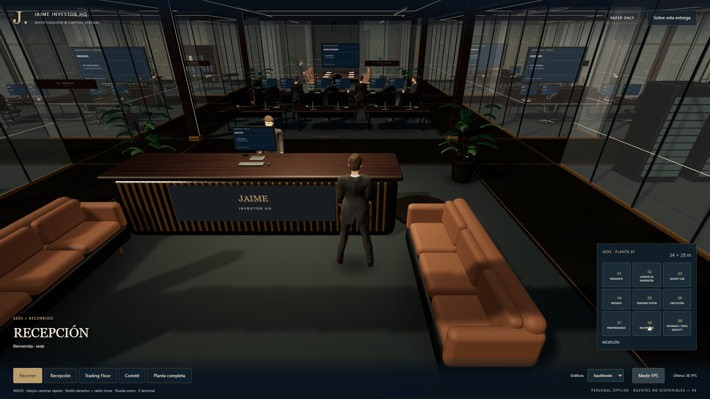
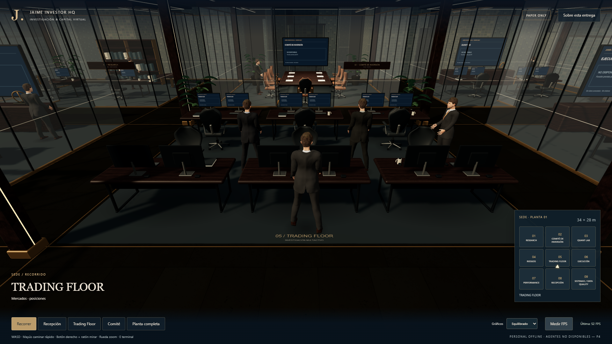
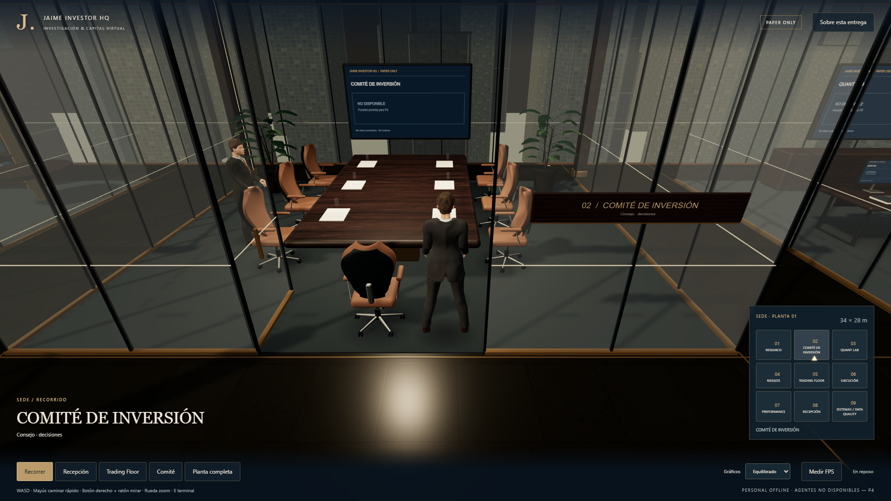
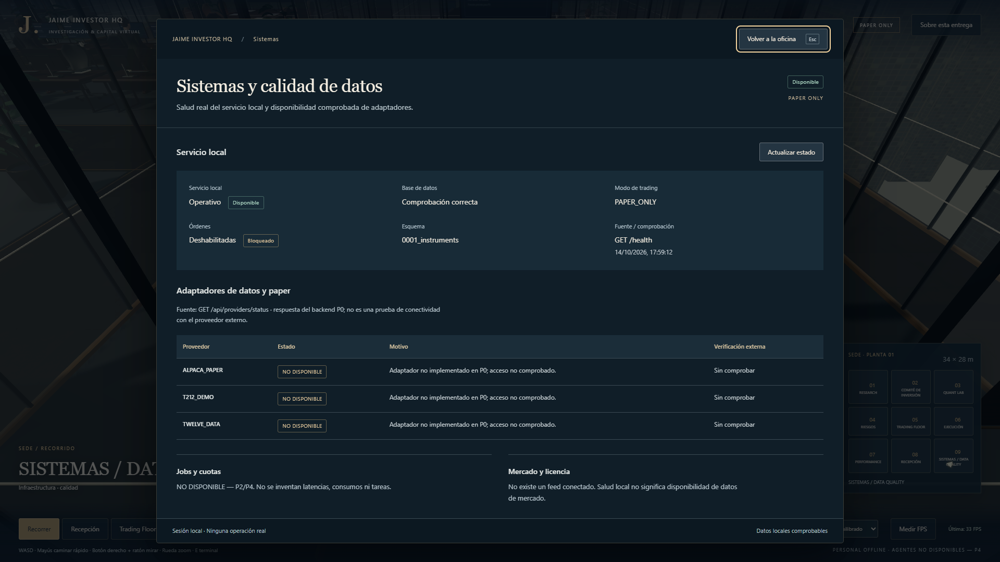

# P1.F · Evidencias finales reales

Capturas de la aplicación Three.js/R3F en Chrome con ANGLE Intel Graphics/D3D11, 1920×1080, Equilibrado/DPR 1. El avatar y los NPC son meshes skinned reales; las imágenes no sustituyen la oficina. Las vistas principales son la cámara jugable elevada detrás del avatar.

## Galería

| Escena | Captura |
|---|---|
| Recepción con avatar | [01](01-recepcion-avatar.png) |
| Trading con avatar y NPC | [02](02-trading-avatar-npc.png) |
| Giro real de cámara | [03](03-giro-camara.png) |
| Comité, pasillo lateral | [04](04-comite-avatar.png) |
| Pasillo, cristal y techo | [05](05-pasillo-cristal-techo.png) |
| Trading, interfaz de posiciones sin datos | [06](06-trading-overlay.png) |
| Sistemas, salud local real y proveedores sin conectar | [07](07-sistemas-overlay.png) |
| Skyline desde la ventana, avatar visible | [08](08-skyline.png) |
| Escena con NPC y minimapa completo | [09](09-escena-npc-minimapa.png) |
| Peticiones de backend abortadas, estado offline real | [10](10-offline.png) |
| Diagnóstico P0 conservado | [11](11-diagnostico-p0.png) |
| Comité desde la entrada | [12](12-comite-entrada.png) |

Planta completa complementaria en [B, cierre integral](../P1B/cierre-integral/02-planta.png). Nueve interfaces con capturas individuales en [P1.D](../P1D/). No se usan panorámicas para acreditar jugabilidad.

## Rendimiento observado

Intel Core 5 120U (10 núcleos/12 hilos), memoria física 16.847.925.248 bytes, Intel Graphics driver 31.0.101.4953. GPU [verificada](gpu.json); renderer real en cada JSON. Ventanas de 12 s con teclas y ratón reales, sin modificar posiciones de jugador desde automatización. Intervalos largos incluidos; se excluyen pestañas ocultas. Los contadores son los del último frame, no un máximo global.

| Escenario | FPS móviles | p95 móvil ms | Muestras móviles | FPS total | p95 total ms | Draw calls | Triángulos | Texturas / geometrías | Datos |
|---|---:|---:|---:|---:|---:|---:|---:|---:|---|
| Recepción | 41,5 | 41,3 | 274 | 37,8 | 35,2 | 204 | 346.188 | 48 / 197 | [JSON](fps-recepcion.json) |
| Trading | 54,1 | 26,4 | 357 | 52,1 | 27,3 | 167 | 340.600 | 48 / 197 | [JSON](fps-trading.json) |
| Giro | 59,9 | 18,4 | 393 | 52,9 | 32,4 | 162 | 367.192 | 49 / 199 | [JSON](fps-giro.json) |
| Comité | 37,6 | 58,5 | 279 | 32,7 | 65,6 | 72 | 167.126 | 49 / 199 | [JSON](fps-comite.json) |
| Pasillo | 34,7 | 62,9 | 258 | 32,8 | 64,4 | 143 | 330.794 | 49 / 199 | [JSON](fps-pasillo.json) |
| Recorrido + monitor | 32,8 | 53,2 | 274 | 28,9 | 64,6 | 141 | 351.162 | 52 / 201 | [JSON](fps-monitor.json) |

[Resumen derivado de los JSON originales](resumen-rendimiento.json). La ventana mide principalmente el recorrido; las aperturas/cierres forman parte del flujo probado y el diálogo detiene el mundo. No se presenta su FPS pausado como rendimiento caminando. Las capturas se toman fuera de las ventanas de los cinco escenarios principales; el flujo combinado incluye capturas y pausas de automatización, que no se descartan.

Los cinco primeros escenarios se midieron antes de conectar el cargador. El flujo de monitor se repitió después: [AC activo, ahorro desactivado](estado-energia-cargador.json). Se conserva el resultado anterior **29,8 FPS móviles** y [su estado de energía](estado-energia.json), batería 17%/ahorro activo: [datos anteriores](fps-monitor-ahorro-bateria.json). No se modificó la configuración de energía ni se atribuye toda variación a la batería.

Todas las medias móviles finales superan 30 FPS; objetivo 45–60 no constante, especialmente en pasillo/Comité/flujo monitor. El promedio total del monitor baja a 28,9 por pausas largas. E había medido [55,1 FPS caminando en Trading](../P1E/movimiento.json); vistas/carga/energía difieren. B sin avatar/NPC era una referencia estática, no una comparación controlada. Arranque observado [inicio](inicio.json): ~2,1 s primer callback, ~6,1 s primer frame GPU, sin certificar carga fría completa del conjunto humano.

## Recorrido y controles

- `recorrido-*.json`: nueve destinos alcanzados caminando con WASD real, sin teletransporte ni escrituras de posición. La ruta se planifica leyendo los colliders de la escena.
- [Controles y nueve teletransportes](controles-teletransportes.json): WASD, ratón derecho, límites de zoom, inspección/retorno y poses reales.
- [Foco Tab/Mayús+Tab](accesibilidad.json): ciclo cerrado real, E/clic y restauración conservados. Se corrigió el paso de foco del diálogo nativo hacia navegador; [fallo inicial](accesibilidad-antes-correccion.txt) conservado.
- `terminal-*.json`: nueve terminales por E y clic sobre píxeles proyectados de la pantalla física; guardas de distancia/frontal/LOS, foco inicial, Escape/cierre, jugador/cámara congelados y transform exacto después del cierre.
- [Cámara final](camara-corregida.json): 5.980 muestras, altura 3,2 m, cero penetraciones y cruces. [Fallo inicial](camara-antes-correccion.json) y [primer barrido insuficiente](camara-primer-barrido.json) conservados; se corrigieron antes del resultado final.
- [Colisiones del avatar](colisiones-avatar.json): 2.159 muestras sin penetraciones (tolerancia numérica 2 mm), teclas reales contra mostrador, mampara, columna y pared. La columna permite deslizar alrededor; no se confunde ese comportamiento con atravesarla.
- [Conjunto de actores](galeria-actores.json): once rigs independientes, diez NPC OFFLINE. [Estado inicial](inicio.json).
- [Offline](offline.json): se abortaron las peticiones locales del navegador, backend intacto; UI informó indisponibilidad y el avatar continuó moviéndose.

## Seguridad, tests y procedencia

[47 pytest + 25 Vitest / TypeScript / build](tests-finales.txt) · [Auditoría: cero vulnerabilidades conocidas](auditoria-dependencias.txt) · [diff-check](git-diff-check.txt) · [P0 HTTP y rechazo LIVE](p0-http.json) · [diagnóstico real](diagnostico-p0.json) · [consola final, cero errores](consola-final.txt) · [red local](red-local.txt).

El log de diff contiene avisos LF/CRLF de Git, sin errores de whitespace. Los logs de comandos conservan la salida stderr y el formato de PowerShell; `NativeCommandError` alrededor de avisos Vite/pip-audit no implica un exit distinto de cero. Los comandos finalizaron correctamente.

[Verificación offline de assets](assets-verificados.json): 33 fuentes humanas, seis mapas PBR, cinco texturas humanas; hashes, glTF real con 163 huesos, cuatro clips y LOD 41.114/13.240/4.040. [Licencias completas](../../../assets/LICENSES.md): gráficos CC0 y herramientas MIT, código MakeHuman AGPL no copiado. Recursos runtime locales, sin CDN. Coste adicional **0 EUR**, ninguna orden real y ningún dato financiero/actividad de agentes inventado.

[Entrega y reproducción](../../ACEPTACION_P1.md). P1 cerrada; **P2 no iniciada**.

[Fuentes y parámetros de las pruebas de navegador](qa/README.md) conservados para revisión/reproducción.
