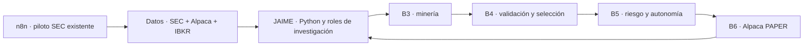

# Hoja de ruta única de JAIME

Revisión 22-11-2026. Esta es la única cola de entregas; [ACTUAL](ACTUAL.md) desarrolla solamente la próxima. [STATUS](../STATUS.md) contiene hechos; [arquitectura](../docs/actual/VISION_Y_ARQUITECTURA.md) contiene diseño. Entregas y documentos históricos no incorporan nuevos «siguientes pasos» a esta cola.

## Esquema mental

El diagrama representa el destino del producto. N/D/R tienen implementación parcial. B3.1 y B3.2 entregaron el laboratorio y una campaña real. B4 validó sus diez ensayos y entregó una decisión de observación. B5 registró esa observación en el ciclo autónomo. B6 ya consume esa decisión en el simulador local. D2 entrega captación con fixtures y D3/B3.2 admiten BRK.B/IEX para alcance exploratorio. El archivo de datos IBKR sigue bloqueado.

## Estado por bloque

| Bloque | Estado real | Condición relevante |
|---|---|---|
| B0/B1 | Completados | Conservar integridad, oficina y stack |
| B2 datos/empresas | Parcial: catálogo amplio, 100 cuentas, 3 modelos, 21 barras AAPL, 252 BRK.B y 3 contratos IBKR | Ampliar cobertura y admitir datasets por uso, no por número de nombres |
| B3 laboratorio | **B3.1 y B3.2 completados**. Motor y primera campaña retrospectiva de diez ensayos | Las campañas más amplias requieren nuevos protocolos y datos elegibles |
| B4 validación | **Entregado**. Contrato temporal, registro completo, costes, pruebas múltiples y selección | Tres variantes reales descartadas y cero sesiones independientes |
| B5 autonomía/riesgo | **Entregado**. Recibo por ventana, motor determinista y vetos | Observación real. Compra, venta y mantener comprobados con datos de prueba |
| B6 ejecución | **En curso.** Contrato y simulador local verificados | Próximo hito, cola durable de envíos con recuperación e idempotencia |

Los antiguos P0–P7 son dominios/especificaciones archivadas. El desarrollo de P5 se reparte aquí entre B3/B4/riesgo B5; P6 corresponde a B6. No pedir autorizaciones de fase ya dadas. LIVE sigue excluido.

## Orden de las próximas entregas

| Orden / ID | Entrega | Salida verificable |
|---|---|---|
| 1 · **B3.1 · COMPLETADO** | Núcleo de laboratorio determinista | 104 tests, tres ensayos sintéticos, costes y registro previo/idempotente; 40 tablas anteriores y MASTER intactos. [Entrega](../docs/actual/ENTREGA_B3_1.md) |
| 2 · **D1 · B2.3 · COMPLETADO** | Acceso real a precios/históricos **IBKR** | Cinco barras diarias y snapshot diferido recibidos; 64 tests, sin archivar precios ni habilitar backtest. [Entrega y límites](../docs/actual/ENTREGA_D1_IBKR_DATOS.md) |
| 3 · **D2 · B2.3 · COMPLETADO CON FIXTURES** | Captación histórica por lotes | Cola durable, ventanas, deduplicación, cuotas/disco; 92 pruebas, fixture 1.000 unidades. Archivo real denegado por derechos pendientes; identidad histórica/calendario/acciones corporativas no admitidos. [Entrega](../docs/actual/ENTREGA_D2_LOTES.md) |
| 4 · **D3 · B2.3 · IMPLEMENTADO** | Validadores y manifiesto congelado | CLI y protocolo estricto conservados. Primera admisión real retrospectiva realizada en B3.2, sin certificar PIT. [Entrega inicial](../docs/actual/ENTREGA_D3_ADMISION.md) |
| 5 · **B3.2 · COMPLETADO** | Primera campaña con datos reales admitidos | [BRK.B/IEX](../docs/actual/ENTREGA_B3_2.md), 252 sesiones, diez ensayos y cero variantes promocionadas; 111 tests y reproducción exacta. Sin PIT/OOS ni ejecución |
| 6 · **B4 · COMPLETADO** | Validación y selección | Diez ensayos contrastados con la campaña sellada. Tres descartes, 0 OOS, expediente reproducible y 168 pruebas. [Entrega](../docs/actual/ENTREGA_B4.md) |
| 7 · **B5 · COMPLETADO** | Autonomía y riesgo | Observación real en n8n, deduplicación por ventana y límites de riesgo PAPER. [Entrega](../docs/actual/ENTREGA_B5.md) |
| 8 · **B6 · EN CURSO** | OMS y Alpaca PAPER | [Simulador completado](../docs/actual/ENTREGA_B6_1.md) → **cola durable de envíos** → conciliación de ejecuciones y estados inciertos → apertura controlada a Alpaca PAPER |

Son entregas de producto, no una promesa de una sola sesión por fila. **No hay requisito de terminar todo B2 para avanzar el laboratorio**. B3.2 admite un caso acotado, no toda la cobertura del catálogo. No promocionar estrategias por haber terminado código o admitir un dataset.

### Los tres cierres de datos antes de campañas reales

1. **Identidad durante el periodo:** clase, símbolo, plaza, moneda y cambios efectivos, con evidencia fechada y aliases. La revisión actual IBKR no demuestra continuidad pasada.
2. **Serie suficiente y coherente:** profundidad acorde a la hipótesis/protocolo, calendario/huecos, splits/dividendos/ajustes y semántica de precios/fills. Las 252 sesiones del diagnóstico son un suelo preliminar, no aceptación estadística.
3. **Uso y cronología admisibles:** derechos concretos, información disponible a cada fecha según las señales, universo/selección/bajas y limitaciones del feed. El histórico actual conocido hoy no se convierte en PIT de mercado. D3 implementa validadores acotados; requieren evidencias confiables del dataset concreto.

D1 verifica acceso acotado IBKR y D2 entrega infraestructura con fixtures, sin cerrar sus derechos de archivo. D3 implementa la evaluación y B3.2 aporta una revisión privada para BRK.B/IEX. Estos controles se aplican a futuros datasets sin repetir la entrega terminada; no abrir D3.1. Si una fuente no cubre el uso o exige pago, registrar la limitación concreta; usar otra existente solo si sirve y está autorizada. No contratar ni cambiar de proveedor silenciosamente ni repetir campañas fallidas sin hipótesis nueva.

## Escala y criterio de continuidad

**Minería, revisión del 20-11-2026.** En la ampliación de B3 se priorizarán ruptura de cierres y rebote tras sobreventa sobre barras diarias elegibles. La revisión de Day Trader también propone medir sensibilidad por bloques cuando llegue un histórico admisible. [Criterios y encaje](../docs/actual/DAY_TRADER_ADAPTACION.md). B5 recibe el expediente de observación ya cerrado. En la siguiente ampliación de B3/B4, extender el genoma a familias ejecutables distintas antes de probar cruces y mutación con DEAP. Comparar la búsqueda adaptativa con una rejilla o muestreo aleatorio a igual presupuesto, en desarrollo. La confirmación requiere candidatas congeladas y muestra independiente. El piloto aislado de Optuna y la vista sin puntuaciones de Crucible adaptada a JAIME ya son comprobables. [Decisiones, resultados y criterios de incorporación](../docs/actual/MINERIA_REPOS_2026_11_20.md).

Objetivo: universo amplio procesado automáticamente por lotes. Catálogo, cobertura financiera, histórico admisible y ejecutabilidad son capacidades distintas. AAPL/MSFT/WMT quedan como regresión; no se profundiza indefinidamente en ellas ni se impone toda la bolsa mundial para probar la tubería. Ampliar por lotes medidos y elegibilidad declarada, sin atribuir cobertura a activos sin datos.

En cada continuación: leer ACTUAL, inspeccionar solo dependencias de esa entrega, implementar, verificar y guardar estado. Si aparece una idea que no resuelve un requisito de aceptación de la entrega activa, pasa al aparcamiento inferior. Solo actualizar el orden por nueva evidencia/mandato y explicar el cambio.

## Aparcamiento — fuera de la cola inmediata

- Nuevas APIs, Yahoo/Stooq, más plazas y segundo piloto europeo; valorar cuando falte un dataset concreto. Nivel 2 no habilitado por esta auditoría.
- Streaming/tiempo real masivo, intradía/opciones, DuckDB/Parquet, vector DB y frameworks nuevos: después de una necesidad/benchmark.
- DCF/comparables/consenso/transcripts y expansión de modelos: B2 empresarial futura; no prerrequisitos de la primera familia de tendencia.
- Debate profundo Bull/Bear/Chair y más skills: P4 PARTIAL; conservar evidencia, esperar hipótesis concreta de mejora.
- Cambiar la ejecución a IBKR o Trading 212: sin entrega activa; ejecutor vigente Alpaca PAPER.
- Nueva obra visual de oficina y reinstalación de SDK/n8n/bootstrap: trabajos aceptados, reabrir solo por defecto reproducible o cambio del usuario.

PAPER ONLY, 0 EUR, separación MASTER/experimentos/brokers y órdenes 403 vigentes. [Auditoría](../docs/actual/AUDITORIA_CONTINUIDAD_2026_11_11.md) · [Plan anterior preservado](../docs/archive/2026-11-11-continuidad/tasks/ROADMAP.md).
